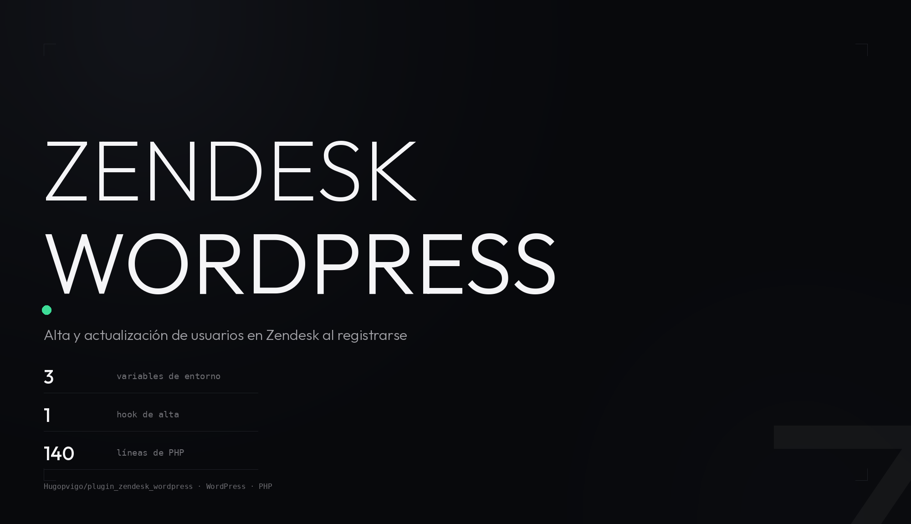

<p align="center">
  
</p>

<p align="center">
  <b>Cada alta en WordPress se refleja en Zendesk como usuario de soporte.</b><br>
  Plugin de un solo archivo: al registrarse alguien, crea o actualiza su ficha en Zendesk
  con el rol <code>end-user</code> y los campos del canal de venta.
</p>

<p align="center">
  
  
  
  
  
</p>

---

## Qué es esto

Un plugin de un solo archivo (`zendesk-woocommerce-integration.php`, 140 líneas) que engancha
WordPress con la API de Zendesk:

- Escucha el hook **`user_register`**.
- Busca al usuario en Zendesk **por correo electrónico** (`GET /api/v2/users/search.json`).
- Si ya existe, lo **actualiza** (`PUT /api/v2/users/{id}.json`); si no, lo **crea**
  (`POST /api/v2/users.json`).
- Lo crea con rol `end-user`, la etiqueta `Travel eSIM` y dos campos personalizados
  (`fecha_creacion` y `canal_de_venta`).

No añade ninguna pantalla al admin: su único efecto es el alta automática en Zendesk.

## Requisitos

| Componente | Versión mínima | Para qué |
|---|---|---|
| WordPress | sin mínimo declarado | La cabecera del plugin no fija versión |
| PHP | 7.2.5 | Lo que pide `vlucas/phpdotenv` 5.6, la única dependencia |
| Composer | 2.x | Instalar `vlucas/phpdotenv` |
| WooCommerce | activo | El plugin no hace nada si no lo encuentra |
| Zendesk | con API de usuarios | Para el token de API |

El plugin comprueba WooCommerce en `active_plugins` y, en multisite, también en
`active_sitewide_plugins`. Si no está, muestra un aviso de error en el admin y no hace nada.

## Instalación

```bash
cd /ruta/al/wp-content/plugins/
git clone https://github.com/Hugopvigo/plugin_zendesk_wordpress.git zendesk-woocommerce-integration
cd zendesk-woocommerce-integration
composer install --no-dev
```

`composer install` **no es opcional**: el plugin carga `vendor/autoload.php` al arrancar y, sin ese
fichero, WordPress da error fatal.

Después, credenciales (fuera del repo, con permisos restrictivos):

```bash
cat > .env <<'EOF'
ZENDESK_SUBDOMAIN=tu_subdominio
ZENDESK_API_USER=tu_usuario_de_api
ZENDESK_API_TOKEN=tu_token_de_api
EOF
chmod 600 .env
```

| Variable | Qué es |
|---|---|
| `ZENDESK_SUBDOMAIN` | El subdominio de la cuenta: con `acme` se llama a `https://acme.zendesk.com/api/v2/…` |
| `ZENDESK_API_USER` | Correo del usuario de API, que es la parte izquierda del `Authorization: Basic` |
| `ZENDESK_API_TOKEN` | Token de API, la parte derecha de esa misma cabecera |

Si falta cualquiera de las tres, el plugin muestra un aviso de error en el admin y **no registra**
el hook: no se crea ningún usuario hasta que estén las tres.

Actívalo desde *Plugins* en el admin. No hay nada que configurar en el panel de WordPress.

## Configuración

Todo se configura por `.env`, en la raíz del plugin. Las tres variables se convierten en constantes
de PHP (`ZENDESK_SUBDOMAIN`, `ZENDESK_API_USER`, `ZENDESK_API_TOKEN`) y se usan para montar la
cabecera `Authorization: Basic base64(usuario:token)` en cada llamada.

En la cuenta de Zendesk conviene que existan los dos campos personalizados que escribe el plugin,
`fecha_creacion` y `canal_de_venta`; y que el usuario de API tenga permiso para crear y modificar
usuarios finales.

## Uso

No hay nada que pulsar: el flujo es el alta de un usuario.

1. Alguien se registra en WordPress (compra en la tienda, crea una cuenta, se suscribe…).
2. WordPress dispara `user_register` con su ID.
3. El plugin busca su correo en Zendesk y crea o actualiza la ficha:

```json
{
  "user": {
    "name": "Nombre Apellido",
    "email": "cliente@example.com",
    "role": "end-user",
    "user_fields": {
      "fecha_creacion": "2026-10-21 09:00:00",
      "canal_de_venta": "Travel eSIM"
    },
    "tags": ["Travel eSIM"],
    "notes": "Travel eSIM"
  }
}
```

El nombre sale del nombre y apellidos del usuario de WordPress; si no los tiene, se usa su
`user_login`.

Un par de cosas que conviene saber:

- **El hook es genérico.** `user_register` se dispara con cualquier alta de usuario de WordPress,
  no solo con clientes de WooCommerce. Si solo quieres sincronizar clientes de la tienda, hay que
  filtrar el alta antes.
- **Los errores no se muestran en el admin.** Si Zendesk rechaza la llamada, el motivo va al log
  de PHP (`error_log`), no a la pantalla. Es el único sitio donde se ve qué ha pasado.

## Hooks principales

| Hook | Tipo | Qué hace |
|---|---|---|
| `user_register` | acción | Crea o actualiza el usuario en Zendesk (recibe el ID del usuario) |
| `admin_notices` | acción | Avisa si faltan credenciales o si WooCommerce no está activo |

Funciones que define el plugin, por si hay que reutilizarlas:

| Función | Qué hace |
|---|---|
| `zendesk_api_request( $endpoint, $method, $data )` | Petición a la API de Zendesk; devuelve el JSON o `false` |
| `get_zendesk_user_id_by_email( $email )` | Devuelve el ID de Zendesk de ese correo, o `false` |
| `create_or_update_zendesk_user_on_registration( $user_id )` | El callback del hook |

## Estructura

```
plugin_zendesk_wordpress/
├── zendesk-woocommerce-integration.php   todo el plugin: env, API de Zendesk y hook
├── composer.json                          dependencia única: vlucas/phpdotenv
├── composer.lock
└── .gitignore                             ignora .env, vendor/ y carpetas de Claude
```

## Licencia

El repositorio está bajo **CC BY-NC-SA 4.0**: se puede compartir y adaptar con
fines no comerciales, citando al autor y manteniendo la misma licencia. Texto
completo en [`LICENSE`](LICENSE).

Ojo: el `composer.json` del plugin declara la licencia `proprietary` y firma
© SUOP Mobile SL — Hugo Pérez-Vigo. Son dos declaraciones que no coinciden;
manda el fichero `LICENSE` del repositorio, pero si el plugin se va a
distribuir en serio conviene alinearlas.
